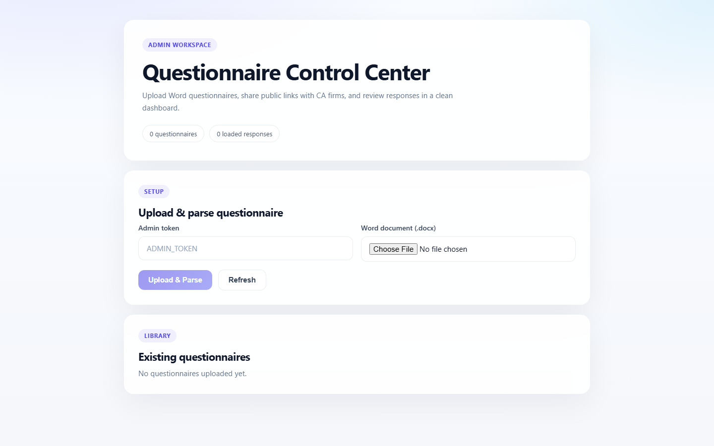

# AI Word Questionnaire

[](LICENSE)
[](docker-compose.yml)
[](backend/)
[](frontend/)

Free, open-source, AI-powered questionnaire app. Upload a `.docx` questionnaire, auto-extract questions, share public links, collect responses with optional Google sign-in, generate AI-assisted drafts, and view a beautiful response dashboard.

> **MIT Licensed — free for everyone to use, modify, and deploy.**

## UI Preview

| Admin Control Center | Respondent Form | Response Dashboard |
|---|---|---|
|  |  |  |

### UI/UX Highlights

- **Clean premium layout** — card-based sections, clear spacing, and readable typography for long questionnaires.
- **Guided respondent flow** — sample draft selector, AI autofill, manual edit/accept/reject, and final review before submit.
- **Dual access modes** — authenticated Google link for verified identity, anonymous link for open collection with name/firm/ID capture.
- **Admin operations** — upload DOCX, copy share links, load responses, export CSV/XLSX, delete questionnaires.
- **Insights dashboard** — aggregate MCQ distribution bars, descriptive response review, individual vs all-response view.
- **Responsive design** — usable on desktop and mobile screens.

## Features

- **DOCX upload & parsing** — extracts single-choice, multi-choice, and descriptive questions (`python-docx`).
- **Public respondent links** — share `/q/{slug}`; authenticated (Google required) or anonymous (`?auth=open`) mode.
- **Google SSO (optional)** — verified respondent identity; anonymous submissions get a stable anonymous ID and optional name/firm.
- **Single response per user** — same Google user or anonymous browser can reopen and update their response.
- **AI autofill** — Ollama or OpenAI-compatible provider; suggestions only from user context, no invented facts.
- **Sample drafts** — 3 built-in profile samples + random draft; auto-fills all 42 questions for review/edit.
- **Admin dashboard** — upload, manage, copy links, load responses, export CSV/XLSX.
- **Response dashboard** — aggregate MCQ distribution charts, descriptive answer review, individual/aggregate toggle.
- **Share view** — read-only `/s/{share_token}` with MCQ + descriptive answers.
- **Docker + Termux** — one-command Docker deploy; Termux script for Android.

## Quick Start (Docker, recommended)

### Prerequisites
- Docker Desktop / Docker Engine + Docker Compose

### Run
```bash
git clone https://github.com/Tapas15/Questly.git
cd Questly
cp .env.example .env
# edit .env: set ADMIN_TOKEN, SESSION_SECRET, optional LLM/webhook/auth.
# Leave FRONTEND_ORIGIN/PUBLIC_BASE_URL empty for quick tunnels/dynamic URLs.
docker compose up --build -d
```

Check status / print URLs:
```bash
docker compose ps
curl http://localhost:8080/api/health   # {"ok":true}
docker compose logs --tail=30 backend   # startup prints Admin + Google OAuth redirect URL
docker compose run --rm urls            # prints Admin Dashboard + Google OAuth redirect URL
```

Open:
- Admin: `http://localhost:8080`
- API health: `http://localhost:8000/api/health`
- After uploading DOCX in Admin, form: `http://localhost:8080/q/<slug>`
- Anonymous form: `http://localhost:8080/q/<slug>?auth=open`
- Dashboard: `http://localhost:8080/dashboard/<slug>`
- Share (read-only, token from Admin): `http://localhost:8080/s/<share_token>`

Stop:
```bash
docker compose down          # keeps data
docker compose down -v       # deletes DB/uploads volumes
```

## Local Development

### Backend
```powershell
cd Questly
python -m venv .venv
.\.venv\Scripts\Activate.ps1
pip install -r backend\requirements.txt
Copy-Item .env.example .env
$env:PYTHONPATH='.'
.\.venv\Scripts\python -m uvicorn backend.app.main:app --reload --port 8000
```

### Frontend
```powershell
cd Questly\frontend
npm install
npm run dev
```
Dev UI: `http://localhost:5173` (proxies `/api` to backend).

## Termux (Android)

### Install & run (after clone)

```bash
pkg update -y
pkg install git -y
git clone https://github.com/Tapas15/Questly.git
cd Questly
chmod +x deploy-termux.sh
./deploy-termux.sh
```

What `deploy-termux.sh` does:
- Installs dependencies (python, nodejs-lts, git, build tools)
- Creates `.venv`, installs `backend/requirements.txt`
- Creates `.env` from `.env.example` if missing (leaves `PUBLIC_BASE_URL`/`FRONTEND_ORIGIN` empty for dynamic URLs)
- Builds frontend and creates `start-termux.sh` / `stop-termux.sh`
- Starts backend + frontend

### Start / stop

```bash
./start-termux.sh
./stop-termux.sh
```

### URLs printed by `start-termux.sh`

The script prints available URLs:
- **Local**: `http://localhost:8080/`, `/api/health`, `/q/<slug>`, `/q/<slug>?auth=open`, `/dashboard/<slug>`
- **LAN**: `http://<phone-ip>:8080/...` (same paths)
- **Cloudflare quick tunnel** (if `cloudflared` installed): prints new `https://<random>.trycloudflare.com/...` URLs and the Google OAuth redirect URI to add.

Install cloudflared on Termux if needed:
```bash
pkg install cloudflared -y
```

> Quick tunnel URL changes every restart. The app accepts the new URL automatically (no `.env` change needed). For Google sign-in, add the newly printed redirect URI: `https://<new-url>/api/auth/callback/google`.
> Data persists in `backend/data` and `backend/uploads`.

Logs: `.run/backend.log`, `.run/frontend.log`, `.run/cloudflared.log`

## Configuration (`.env`)

| Variable | Default | Description |
|---|---|---|
| `DATABASE_URL` | `sqlite:///./backend/data/app.db` | SQLite default; set PostgreSQL URL for Postgres. |
| `ADMIN_TOKEN` | `changeme` | Admin API token for upload/export/delete/responses. |
| `FRONTEND_ORIGIN` | empty | Optional fixed frontend/public origin. Leave empty for quick tunnels; app infers active origin from request headers. |
| `PUBLIC_BASE_URL` | empty | Optional fixed public base URL for generated links/OAuth redirects. Leave empty for quick tunnels. |
| `LLM_PROVIDER` | `ollama` | `ollama` or `openai_compatible`. |
| `OLLAMA_BASE_URL` | `http://localhost:11434` | Ollama endpoint. Docker: `http://host.docker.internal:11434`. |
| `OLLAMA_MODEL` | `llama3.1` | Ollama model. |
| `LLM_API_KEY` | empty | API key for OpenAI-compatible provider. |
| `LLM_BASE_URL` | empty | e.g. `https://api.kilo.ai/api/gateway`. |
| `LLM_MODEL` | `gpt-4o-mini` | Model id for compatible provider. |
| `SESSION_SECRET` | `change-this-session-secret` | Strong random secret for auth sessions. |
| `AUTH_REQUIRED_FOR_SUBMIT` | `false` | Require sign-in before submit. |
| `AUTH_REQUIRED_PROVIDER` | `google` | `google`, `microsoft`, or `any`. |
| `GOOGLE_CLIENT_ID` / `GOOGLE_CLIENT_SECRET` | empty | Google OAuth credentials. |
| `MICROSOFT_CLIENT_ID` / `MICROSOFT_CLIENT_SECRET` | empty | Microsoft OAuth credentials. |
| `MICROSOFT_TENANT` | `common` | Microsoft tenant. |
| `RESPONSE_WEBHOOK_URL` | empty | Google Apps Script Web app URL (`https://script.google.com/macros/s/.../exec`) that receives submit payloads. |
| `RESPONSE_WEBHOOK_SECRET` | empty | Optional shared secret sent as `X-Webhook-Secret`; must match script `SHARED_SECRET`. |
| `RESPONSE_WEBHOOK_ENABLED` | `true` | Enable webhook delivery when URL is set. |

## Google Sign-In Setup (public authenticated link)

1. Set in `.env`:
   ```env
   PUBLIC_BASE_URL=https://your-domain
   FRONTEND_ORIGIN=https://your-domain
   SESSION_SECRET=<strong-random-secret>
   AUTH_REQUIRED_FOR_SUBMIT=true
   AUTH_REQUIRED_PROVIDER=google
   GOOGLE_CLIENT_ID=<client-id>
   GOOGLE_CLIENT_SECRET=<client-secret>
   ```
2. In Google Cloud Console → APIs & Services → Credentials → OAuth client (Web app), add redirect URI:
   ```
   https://your-domain/api/auth/callback/google
   ```
3. Redeploy: `docker compose up --build -d`
4. Share Admin’s **Authenticated link**. Respondents sign in with Google before submit; identity is attached to response.

### Cloudflare quick tunnel (URL changes on restart)

Quick tunnels (`cloudflared tunnel --url http://localhost:8080`) generate a random `*.trycloudflare.com` URL on each restart. This app now supports that mode **without changing `.env`**:

- Leave `PUBLIC_BASE_URL` and `FRONTEND_ORIGIN` empty.
- Start app (Docker or Termux), then run: `cloudflared tunnel --url http://localhost:8080`
- Use the printed `https://....trycloudflare.com` URL. App accepts the new URL automatically (dynamic CORS/origin/redirect handling).
- Data stays in Docker volumes `backend_data`/`backend_uploads` across URL changes and container restarts (`docker compose down -v` deletes data).

**Google OAuth caveat:** Google requires each redirect URI to be pre-registered. For quick tunnels, you must add the new `https://<current-tunnel>.trycloudflare.com/api/auth/callback/google` in Google Cloud Console after every tunnel restart. The app cannot bypass this Google security rule. For a permanent URL, use a named Cloudflare Tunnel/custom domain and set fixed `PUBLIC_BASE_URL`/`FRONTEND_ORIGIN`.

## Google Sheets / Structured Export (No Google OAuth in App)

For a simple “no-auth in app” flow, use a Google Apps Script web app as a webhook. Questly POSTs a structured JSON payload on every submit; the script appends a row to Google Sheets.

### Where to get `RESPONSE_WEBHOOK_URL`

`RESPONSE_WEBHOOK_URL` is the **Google Apps Script Web app URL** (looks like `https://script.google.com/macros/s/<DEPLOYMENT_ID>/exec`). You get it after deploying the script:

1. Open your Google Sheet → **Extensions** → **Apps Script**.
2. Paste the script below and set `SHARED_SECRET`.
3. Click **Deploy** → **New deployment**.
4. Click gear icon → select **Web app**.
5. Set **Execute as** = `Me`.
6. Set **Who has access** = `Anyone` (for public form submissions). If your users are all in your Workspace and you prefer restricted access, choose the Workspace option, but test webhook delivery.
7. Click **Deploy**, authorize access, then copy the **Web app URL**. This copied URL is your `RESPONSE_WEBHOOK_URL`.

> If you edit the script later, use **Deploy** → **Manage deployments** → edit → **New version** → Deploy. The URL usually stays the same for that deployment; copy it again to be safe.

### 1) Create Google Sheet + Apps Script

1. Create a Google Sheet (e.g. `Questly Responses`).
2. Extensions → **Apps Script**.
3. Replace `Code.gs` with:

```javascript
const SHEET_NAME = 'Responses';
const SHARED_SECRET = 'J6F7Jslm0Mi2GYLfh-dA4O7B238v-12AJSTjDBVZYbI'; // must match RESPONSE_WEBHOOK_SECRET

function doPost(e) {
  try {
    const secret = (e.parameter.secret || e.postData.headers['X-Webhook-Secret'] || e.postData.headers['x-webhook-secret'] || '').toString();
    if (SHARED_SECRET && secret !== SHARED_SECRET) {
      return json({ ok: false, error: 'unauthorized' }, 401);
    }
    const payload = JSON.parse(e.postData.contents);
    const ss = SpreadsheetApp.getActiveSpreadsheet();
    const sheet = ss.getSheetByName(SHEET_NAME) || ss.insertSheet(SHEET_NAME);

    const baseHeaders = ['submitted_at','response_id','status','updated','identity','name','email','firm','city','role','contact','ai_instruction'];
    const qHeaders = (payload.questions || []).map(q => `Q${q.number}: ${q.text}`.slice(0, 150));
    const headers = baseHeaders.concat(qHeaders);
    ensureHeaders(sheet, headers);

    const r = payload.respondent || {};
    const row = [
      payload.submitted_at || '',
      payload.response_id || '',
      payload.status || '',
      payload.updated ? 'yes' : 'no',
      r.identity || '',
      r.name || '',
      r.email || '',
      r.firm || '',
      r.city || '',
      r.role || '',
      r.contact || '',
      payload.ai_instruction || ''
    ];
    (payload.questions || []).forEach(q => row.push(q.answer || ''));
    sheet.appendRow(row);
    return json({ ok: true });
  } catch (err) {
    return json({ ok: false, error: String(err) }, 500);
  }
}

function ensureHeaders(sheet, headers) {
  if (sheet.getLastRow() === 0) {
    sheet.appendRow(headers);
    sheet.setFrozenRows(1);
    return;
  }
  const current = sheet.getRange(1, 1, 1, sheet.getLastColumn()).getValues()[0];
  if (current.length < headers.length) {
    sheet.getRange(1, current.length + 1, 1, headers.length - current.length).setValues([headers.slice(current.length)]);
  }
}

function json(obj, code) {
  return ContentService.createTextOutput(JSON.stringify(obj))
    .setMimeType(ContentService.MimeType.JSON);
}
```

4. Deploy → **New deployment** → type **Web app**.
   - Execute as: **Me**
   - Who has access: **Anyone** (or Anyone with Google account if internal; “Anyone” is easiest for webhook)
5. Copy the **Web app URL** — this is the value for `RESPONSE_WEBHOOK_URL`. It should end with `/exec`.

### 2) Configure Questly

Add to `.env`:

```env
RESPONSE_WEBHOOK_URL=https://script.google.com/macros/s/<DEPLOYMENT_ID>/exec  # copied from Apps Script Deploy > Web app
RESPONSE_WEBHOOK_SECRET=J6F7Jslm0Mi2GYLfh-dA4O7B238v-12AJSTjDBVZYbI  # same value as SHARED_SECRET in script
RESPONSE_WEBHOOK_ENABLED=true
```

Redeploy/restart backend (`docker compose up --build -d`).

### 3) Payload shape

Questly sends structured JSON:

- `respondent`: identity, name, email, firm, city, role, contact
- `questions[]`: `number`, `text`, `type`, `section`, `answer` (human-readable)
- `answers_flat`: `Q1..Qn` keys for easy automation
- `raw_answers`: original answer values

This gives both a readable Sheets row and machine-friendly fields.

## Usage

1. Open Admin (`/`), enter `ADMIN_TOKEN`.
2. Upload `.docx` questionnaire.
3. Copy links from Admin:
   - **Authenticated link**: `/q/{slug}` — Google sign-in required.
   - **Anonymous link**: `/q/{slug}?auth=open` — no sign-in; name/firm requested for identification.
   - **Share view**: `/s/{share_token}` — read-only MCQ+descriptive summary.
4. Respondent fills/edits answers; can use sample drafts or AI suggestions; submits. Same user can reopen and update their response.
5. Admin loads responses, exports CSV/XLSX, or opens **Dashboard** (`/dashboard/{slug}`) for aggregate/individual insights.

## API (main)

| Method | Path | Auth | Description |
|---|---|---|---|
| POST | `/api/questionnaires/upload` | Admin | Upload/parse DOCX |
| GET | `/api/questionnaires` | Admin | List questionnaires |
| GET | `/api/questionnaires/{slug}` | Public | Get questionnaire + sample prefill |
| GET | `/api/questionnaires/{slug}/sample?profile=` | Public | Random or profile sample draft |
| POST | `/api/questionnaires/{slug}/suggest-all` | Public | AI suggestions for all questions |
| POST | `/api/questionnaires/{slug}/submit?auth=required|optional` | Public/session | Submit or update own response |
| GET | `/api/questionnaires/{slug}/my-response` | Session | Get current user's existing response |
| GET | `/api/questionnaires/{slug}/responses` | Admin | List responses |
| GET | `/api/questionnaires/{slug}/responses.csv|xlsx` | Admin | Export |
| GET | `/api/share/{token}` | Public | Read-only share view |
| GET | `/api/auth/providers` `/login/*` `/callback/*` `/me` `/logout` | Public | OAuth/session auth |

## Security & Privacy Notes

- Do not commit `.env` or real API keys. `.gitignore` excludes `.env`, data, uploads, logs.
- Set strong `ADMIN_TOKEN` and `SESSION_SECRET` in production.
- Google/Microsoft OAuth secrets must be kept server-side.
- Anonymous responses are identified by cookie-based anon ID and optional name/firm; not identity-proof.
- AI suggestions are sanitized server-side; invalid MCQ values discarded; no invented facts instructed.

## Development

```bash
# backend parser smoke test
$env:PYTHONPATH='.'; python -c "from backend.tests.test_parser import test_parse_questionnaire_counts; test_parse_questionnaire_counts(); print('ok')"

# frontend build
cd frontend && npm run build
```

## License

[MIT](LICENSE) — free for everyone to use, modify, distribute, and commercialize, with attribution and no warranty.
