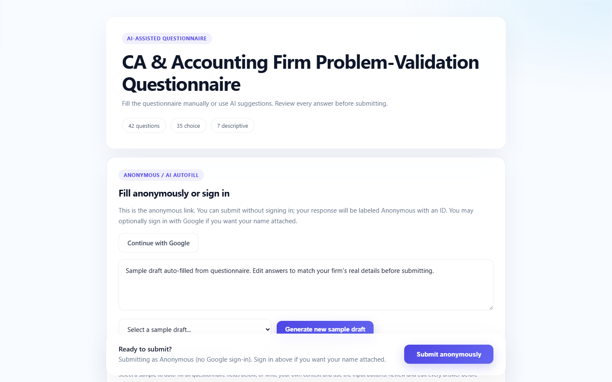
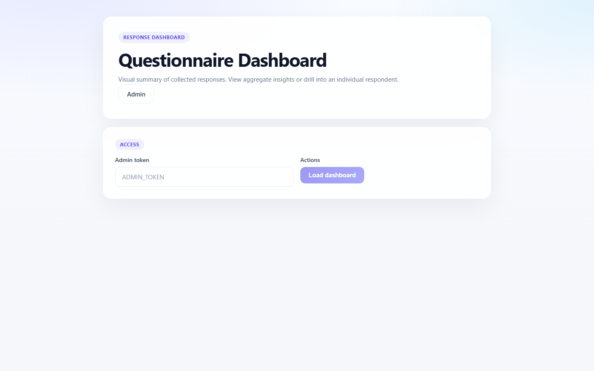

# AI Word Questionnaire

[](LICENSE)
[](docker-compose.yml)
[](backend/)
[](frontend/)

Free, open-source, AI-powered questionnaire app. Upload a `.docx` questionnaire, auto-extract questions, share public links, collect responses with optional Google sign-in, generate AI-assisted drafts, and view a response dashboard.

> **MIT Licensed** — free for everyone to use, modify, and deploy.

## Table of Contents

- [UI Preview](#ui-preview)
- [Features](#features)
- [Architecture](#architecture)
- [Quick Start (Docker)](#quick-start-docker-recommended)
- [Local Development](#local-development)
- [Termux / proot-distro (Android)](#termux--proot-distro-android)
- [Configuration](#configuration-env)
- [Google Sign-In](#google-sign-in-setup)
- [Google Sheets / Webhook Export](#google-sheets--structured-export)
- [Usage](#usage)
- [API Reference](#api-reference)
- [Security & Privacy](#security--privacy-notes)
- [Development & Tests](#development--tests)
- [License](#license)

## UI Preview

| Admin Control Center | Respondent Form | Response Dashboard |
|---|---|---|
|  |  |  |

### UI/UX Highlights

- **Clean premium layout** — card-based sections, clear spacing, readable typography for long questionnaires.
- **Guided respondent flow** — sample draft selector, AI autofill, manual edit/accept/reject, and final review before submit.
- **Dual access modes** — authenticated Google link for verified identity, anonymous link for open collection with name/firm/ID capture.
- **Admin operations** — upload DOCX, copy share links, load responses, export CSV/XLSX, delete questionnaires.
- **Insights dashboard** — aggregate MCQ distribution charts, descriptive response review, individual vs all-response view.
- **Responsive design** — usable on desktop and mobile screens.

## Features

- **DOCX upload & parsing** — extracts single-choice, multi-choice, and descriptive questions (`python-docx`).
- **Public respondent links** — share `/q/{slug}`; authenticated (Google required) or anonymous (`?auth=open`) mode.
- **Google SSO (optional)** — verified respondent identity; anonymous submissions get a stable anonymous ID and optional name/firm.
- **Single response per user** — same Google user or anonymous browser can reopen and update their response.
- **AI autofill** — Ollama or OpenAI-compatible provider; suggestions only from user context, no invented facts.
- **Sample drafts** — 3 built-in profile samples + random draft; auto-fills questions for review/edit.
- **Admin dashboard** — upload, manage, copy links, load responses, export CSV/XLSX.
- **Response dashboard** — aggregate MCQ charts, descriptive answer review, individual/aggregate toggle.
- **Share view** — read-only `/s/{share_token}` with MCQ + descriptive answers.
- **Deployment options** — Docker Compose, local dev, Termux/proot-distro.

## Architecture

| Layer | Tech | Key paths |
|---|---|---|
| Backend | FastAPI, SQLAlchemy, Pydantic Settings, python-docx, Authlib, httpx, openpyxl | `backend/app/main.py`, `backend/app/config.py`, `backend/app/routers/`, `backend/app/services/` |
| Frontend | React 19, TypeScript, Vite, React Router | `frontend/src/App.tsx`, `frontend/src/pages/`, `frontend/src/api/client.ts` |
| Deploy | Docker Compose, Nginx, Termux/proot scripts | `docker-compose.yml`, `frontend/nginx.conf`, `deploy-termux.sh`, `deploy-proot.sh` |

### Repository Structure

```text
formfill/
├── README.md
├── DOCKER.md
├── docker-compose.yml
├── .env.example
├── deploy-termux.sh              # native Termux script (may fail on pydantic-core builds)
├── deploy-proot.sh               # recommended for Android/proot-distro Linux
├── starting.log                  # generated runtime URL log
├── CA_Accounting_Firm_Problem_Validation_Questionnaire.docx
├── backend/
│   ├── Dockerfile
│   ├── requirements.txt
│   ├── app/
│   │   ├── main.py               # FastAPI app, dynamic CORS, session, startup migrations
│   │   ├── config.py             # env settings
│   │   ├── db.py / models.py / schemas.py
│   │   ├── routers/              # questionnaires.py, auth.py
│   │   └── services/             # parser.py, autofill.py, llm.py, export.py, webhook.py
│   └── tests/
├── frontend/
│   ├── Dockerfile
│   ├── nginx.conf
│   ├── package.json
│   └── src/
│       ├── App.tsx / api/client.ts / types.ts
│       ├── pages/                # AdminPage, FormPage, DashboardPage, SharedPage
│       └── components/QuestionCard.tsx
├── docs/screenshots/
└── scripts/                      # starting-log helpers
```

## Quick Start (Docker, recommended)

### Prerequisites

- Docker Desktop / Docker Engine + Docker Compose

### Run

```bash
git clone https://github.com/Tapas15/Questly.git
cd Questly
cp .env.example .env
# Edit .env: set ADMIN_TOKEN, SESSION_SECRET, optional LLM/webhook/auth.
# Leave FRONTEND_ORIGIN/PUBLIC_BASE_URL empty for quick tunnels/dynamic URLs.
docker compose up --build -d
```

### Check status / URLs

```bash
docker compose ps
docker compose run --rm urls   # writes starting.log with local + cloudflare URLs
```

```powershell
Get-Content starting.log        # PowerShell
# or: type starting.log         # cmd
```

`starting.log` contains:

- `Admin Dashboard (Local)`
- `Admin Dashboard (Cloudflare)`
- `Google OAuth Redirect URL (Local)`
- `Google OAuth Redirect URL (Cloudflare)`
- `Cloudflare URL`

If `cloudflared` is running and writing `cloudflared.err.log` in the project root, `docker compose run --rm urls` auto-detects the latest tunnel URL. You can also run:

```powershell
powershell -ExecutionPolicy Bypass -File scripts/update-starting-log.ps1
```

### Open

| URL | Purpose |
|---|---|
| `http://localhost:8080` | Admin dashboard |
| `http://localhost:8000/api/health` | API health |
| `http://localhost:8080/q/<slug>` | Authenticated/public form (after DOCX upload) |
| `http://localhost:8080/q/<slug>?auth=open` | Anonymous form |
| `http://localhost:8080/dashboard/<slug>` | Analytics dashboard |
| `http://localhost:8080/s/<share_token>` | Read-only share view |

### Stop

```bash
docker compose down          # keeps data
docker compose down -v       # deletes DB/uploads volumes
```

## Local Development

### Backend

```powershell
cd Questly
python -m venv .venv
.\.venv\Scripts\Activate.ps1
pip install -r backend\requirements.txt
Copy-Item .env.example .env
$env:PYTHONPATH='.'
.\.venv\Scripts\python -m uvicorn backend.app.main:app --reload --port 8000
```

### Frontend

```powershell
cd Questly\frontend
npm install
npm run dev
```

Dev UI: `http://localhost:5173` (proxies `/api` to backend).

## Termux / proot-distro (Android)

> **Recommended:** use `proot-distro` Ubuntu/Debian for this app. Native Termux pip installs can fail building `pydantic-core` (Rust/maturin) for `pydantic>=2.7`.

### Option A: proot-distro (recommended)

On Termux host:

```bash
pkg update -y
pkg install proot-distro git -y
proot-distro install ubuntu
proot-distro login ubuntu
```

Inside Ubuntu proot:

```bash
apt-get update && apt-get install -y git
git clone https://github.com/Tapas15/Questly.git
cd Questly
chmod +x deploy-proot.sh
./deploy-proot.sh
```

`deploy-proot.sh` installs apt deps + Node.js 20, creates `.venv`, installs backend deps, builds frontend, creates `.env` if missing, and generates `start-proot.sh` / `stop-proot.sh`.

Start/stop/logs:

```bash
./start-proot.sh
./stop-proot.sh
cat starting.log
tail -f .run/backend.log .run/frontend.log
```

### Option B: Native Termux (best effort)

```bash
pkg update -y
pkg install git -y
git clone https://github.com/Tapas15/Questly.git
cd Questly
chmod +x deploy-termux.sh
./deploy-termux.sh
```

If you hit `pydantic-core`/Rust build errors, switch to Option A.

### Cloudflare quick tunnel

```bash
cloudflared tunnel --url http://localhost:8080
```

- Quick tunnel URL changes every restart; the app accepts the new URL automatically when `PUBLIC_BASE_URL`/`FRONTEND_ORIGIN` are empty.
- For Google sign-in, add the current `https://<tunnel>.trycloudflare.com/api/auth/callback/google` to Google Cloud Console after each tunnel restart.
- For a permanent URL, use a named Cloudflare Tunnel/custom domain and set fixed `PUBLIC_BASE_URL`/`FRONTEND_ORIGIN`.

## Configuration (`.env`)

Copy `.env.example` to `.env` and adjust as needed.

| Variable | Default | Description |
|---|---|---|
| `DATABASE_URL` | `sqlite:///./backend/data/app.db` | SQLite default; set PostgreSQL URL for Postgres. |
| `ADMIN_TOKEN` | `changeme` | Admin API token for upload/export/delete/responses. |
| `FRONTEND_ORIGIN` | empty | Optional fixed frontend/public origin. Leave empty for dynamic/tunnel URLs. |
| `PUBLIC_BASE_URL` | empty | Optional fixed public base URL for generated links/OAuth redirects. Leave empty for dynamic/tunnel URLs. |
| `LLM_PROVIDER` | `ollama` | `ollama` or `openai_compatible`. |
| `OLLAMA_BASE_URL` | `http://localhost:11434` | Ollama endpoint. Docker host: `http://host.docker.internal:11434`. |
| `OLLAMA_MODEL` | `llama3.1` | Ollama model. |
| `LLM_API_KEY` | empty | API key for OpenAI-compatible provider. |
| `LLM_BASE_URL` | empty | e.g. `https://api.kilo.ai/api/gateway`. |
| `LLM_MODEL` | `gpt-4o-mini` | Model id for compatible provider. |
| `SESSION_SECRET` | `change-this-session-secret` | Strong random secret for auth sessions. |
| `AUTH_REQUIRED_FOR_SUBMIT` | `false` (example: `true`) | Require sign-in before submit. |
| `AUTH_REQUIRED_PROVIDER` | `google` | `google`, `microsoft`, or `any`. |
| `GOOGLE_CLIENT_ID` / `GOOGLE_CLIENT_SECRET` | empty | Google OAuth credentials. |
| `MICROSOFT_CLIENT_ID` / `MICROSOFT_CLIENT_SECRET` | empty | Microsoft OAuth credentials. |
| `MICROSOFT_TENANT` | `common` | Microsoft tenant. |
| `RESPONSE_WEBHOOK_URL` | empty | Webhook endpoint receiving submit payloads (e.g. Google Apps Script Web app URL). |
| `RESPONSE_WEBHOOK_SECRET` | empty | Optional shared secret sent as `X-Webhook-Secret`. |
| `RESPONSE_WEBHOOK_ENABLED` | `true` | Enable webhook delivery when URL is set. |

## Google Sign-In Setup

1. Set in `.env`:

   ```env
   PUBLIC_BASE_URL=https://your-domain
   FRONTEND_ORIGIN=https://your-domain
   SESSION_SECRET=<strong-random-secret>
   AUTH_REQUIRED_FOR_SUBMIT=true
   AUTH_REQUIRED_PROVIDER=google
   GOOGLE_CLIENT_ID=<client-id>
   GOOGLE_CLIENT_SECRET=<client-secret>
   ```

2. In Google Cloud Console → APIs & Services → Credentials → OAuth client (Web app), add redirect URI:

   ```text
   https://your-domain/api/auth/callback/google
   ```

3. Redeploy:

   ```bash
   docker compose up --build -d
   ```

4. Share the Admin **Authenticated link**. Respondents sign in with Google before submit.

### Cloudflare quick tunnel caveat

Quick tunnels (`*.trycloudflare.com`) change on restart. The app handles dynamic origin/redirect inference, but Google still requires the exact redirect URI to be pre-registered. Add the current tunnel callback from `starting.log` after each restart, or use a named/custom domain for stable OAuth.

## Google Sheets / Structured Export

Use a Google Apps Script Web app webhook. Questly POSTs structured JSON on every submit.

### 1. Create Apps Script webhook

1. Open your Google Sheet → **Extensions** → **Apps Script**.
2. Paste the script below and set `SHARED_SECRET`.
3. Deploy as **Web app**: Execute as **Me**, Who has access **Anyone** (or Workspace as needed).
4. Copy the Web app URL (`.../exec`) into `RESPONSE_WEBHOOK_URL`.

```javascript
const SHEET_NAME = 'Responses';
const SHARED_SECRET = 'replace-with-your-secret'; // must match RESPONSE_WEBHOOK_SECRET

function doPost(e) {
  try {
    const secret = (e.parameter.secret || e.postData.headers['X-Webhook-Secret'] || e.postData.headers['x-webhook-secret'] || '').toString();
    if (SHARED_SECRET && secret !== SHARED_SECRET) {
      return json({ ok: false, error: 'unauthorized' }, 401);
    }
    const payload = JSON.parse(e.postData.contents);
    const ss = SpreadsheetApp.getActiveSpreadsheet();
    const sheet = ss.getSheetByName(SHEET_NAME) || ss.insertSheet(SHEET_NAME);

    const baseHeaders = ['submitted_at','response_id','status','updated','identity','name','email','firm','city','role','contact','ai_instruction'];
    const qHeaders = (payload.questions || []).map(q => `Q${q.number}: ${q.text}`.slice(0, 150));
    const headers = baseHeaders.concat(qHeaders);
    ensureHeaders(sheet, headers);

    const r = payload.respondent || {};
    const row = [
      payload.submitted_at || '',
      payload.response_id || '',
      payload.status || '',
      payload.updated ? 'yes' : 'no',
      r.identity || '',
      r.name || '',
      r.email || '',
      r.firm || '',
      r.city || '',
      r.role || '',
      r.contact || '',
      payload.ai_instruction || ''
    ];
    (payload.questions || []).forEach(q => row.push(q.answer || ''));
    sheet.appendRow(row);
    return json({ ok: true });
  } catch (err) {
    return json({ ok: false, error: String(err) }, 500);
  }
}

function ensureHeaders(sheet, headers) {
  if (sheet.getLastRow() === 0) {
    sheet.appendRow(headers);
    sheet.setFrozenRows(1);
    return;
  }
  const current = sheet.getRange(1, 1, 1, sheet.getLastColumn()).getValues()[0];
  if (current.length < headers.length) {
    sheet.getRange(1, current.length + 1, 1, headers.length - current.length).setValues([headers.slice(current.length)]);
  }
}

function json(obj) {
  return ContentService.createTextOutput(JSON.stringify(obj))
    .setMimeType(ContentService.MimeType.JSON);
}
```

### 2. Configure Questly

```env
RESPONSE_WEBHOOK_URL=https://script.google.com/macros/s/<DEPLOYMENT_ID>/exec
RESPONSE_WEBHOOK_SECRET=replace-with-your-secret
RESPONSE_WEBHOOK_ENABLED=true
```

Redeploy/restart backend after changing env.

### 3. Payload shape

Questly sends structured JSON including:

- `respondent`: identity, name, email, firm, city, role, contact
- `questions[]`: number, text, type, section, human-readable answer
- `answers_flat`: `Q1..Qn` keys
- `raw_answers`: original answer values

## Usage

1. Open Admin (`/`) and enter `ADMIN_TOKEN`.
2. Upload a `.docx` questionnaire.
3. Copy links from Admin:
   - **Authenticated link**: `/q/{slug}` — Google sign-in required (when enabled).
   - **Anonymous link**: `/q/{slug}?auth=open` — no sign-in; name/firm requested.
   - **Share view**: `/s/{share_token}` — read-only MCQ+descriptive summary.
4. Respondent fills/edits answers; can use sample drafts or AI suggestions; submits. Same user/browser identity can reopen and update their response.
5. Admin loads responses, exports CSV/XLSX, or opens **Dashboard** (`/dashboard/{slug}`).

## API Reference

Main endpoints (see routers for full behavior):

| Method | Path | Auth | Description |
|---|---|---|---|
| `POST` | `/api/questionnaires/upload` | Admin | Upload/parse DOCX |
| `GET` | `/api/questionnaires` | Admin | List questionnaires |
| `GET` | `/api/questionnaires/{slug}` | Public | Get questionnaire + sample prefill |
| `GET` | `/api/questionnaires/{slug}/sample?profile=` | Public | Random or profile sample draft |
| `POST` | `/api/questionnaires/{slug}/suggest-all` | Public | AI suggestions for all questions |
| `POST` | `/api/questionnaires/{slug}/suggest-question` | Public | AI suggestion for one question |
| `POST` | `/api/questionnaires/{slug}/submit?auth=required\|optional` | Public/session | Submit or update own response |
| `GET` | `/api/questionnaires/{slug}/my-response` | Session | Get current user's existing response |
| `GET` | `/api/questionnaires/{slug}/responses` | Admin | List responses |
| `GET` | `/api/questionnaires/{slug}/responses.csv\|xlsx` | Admin | Export responses |
| `GET` | `/api/share/{token}` | Public | Read-only share view |
| `GET/POST` | `/api/auth/*` | Public | OAuth providers, login/callback, me, logout |
| `GET` | `/api/health` | Public | Health check |

## Security & Privacy Notes

- Do **not** commit `.env` or real API keys. `.gitignore` excludes `.env`, data, uploads, logs.
- Set strong `ADMIN_TOKEN` and `SESSION_SECRET` in production.
- Keep Google/Microsoft OAuth secrets server-side.
- Anonymous responses are cookie-based IDs plus optional name/firm; **not identity-proof**.
- AI suggestions are sanitized server-side; invalid MCQ values are discarded; prompt instructs no invented facts.
- Webhook delivery is best-effort and reported in submit response; failures should be monitored via backend logs.

## Development & Tests

```bash
# backend parser smoke test
$env:PYTHONPATH='.'; python -c "from backend.tests.test_parser import test_parse_questionnaire_counts; test_parse_questionnaire_counts(); print('ok')"

# frontend build
cd frontend && npm run build
```

> Note: `backend/tests/test_api_smoke.py` is smoke-oriented and sets env vars after app import; for strict isolation, run with a fresh process/config reload.

## License

[MIT](LICENSE) — free for everyone to use, modify, distribute, and commercialize, with attribution and no warranty.